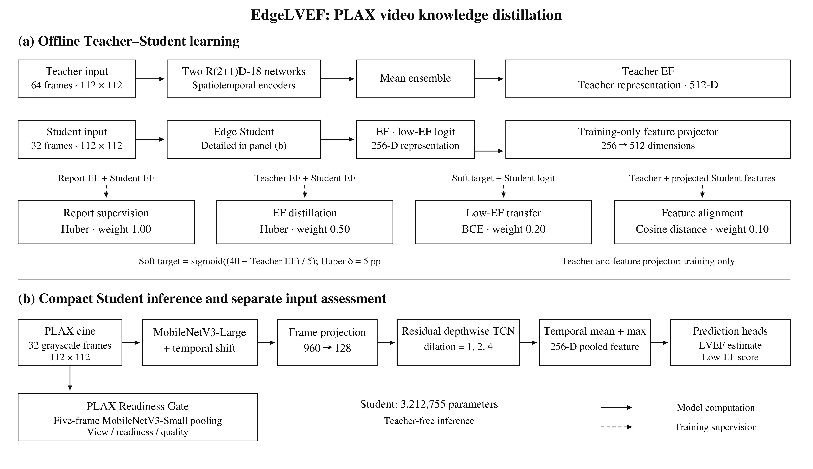
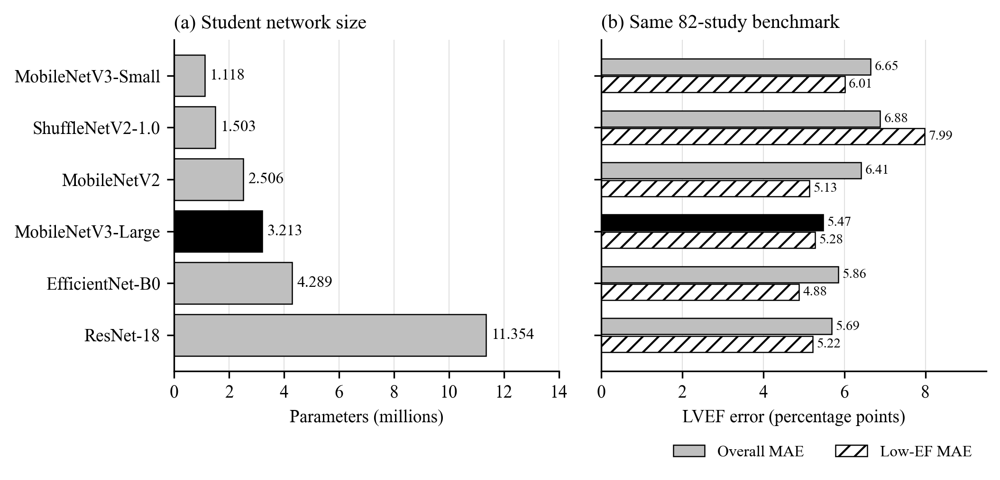
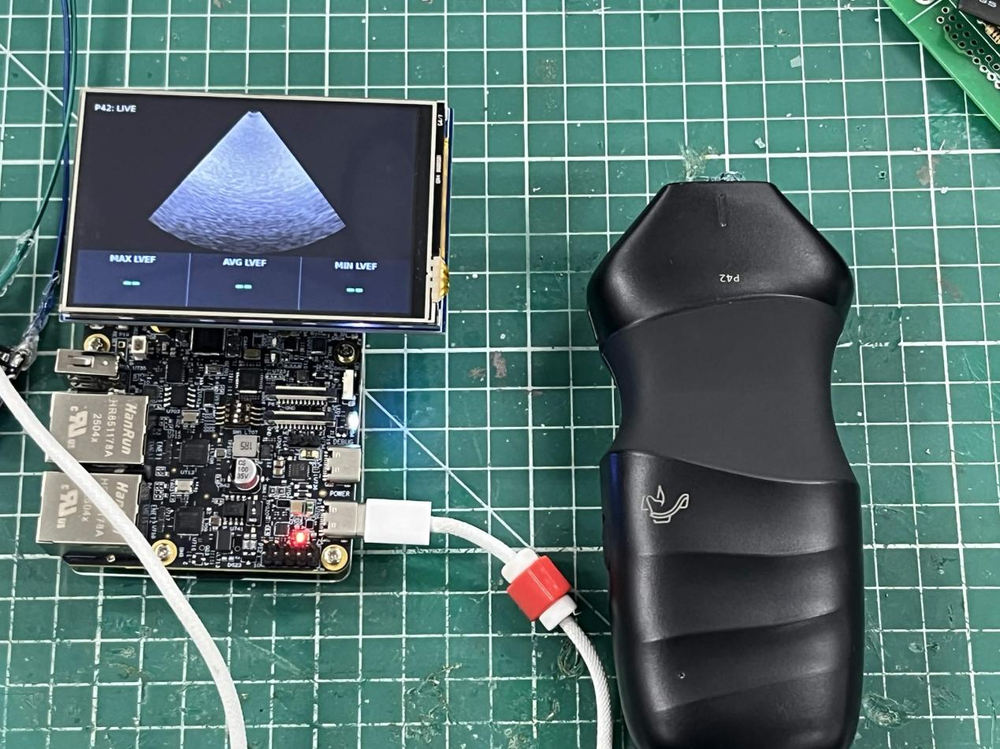

# EdgeLVEF
## Efficient PLAX Video Analysis for Portable Cardiac Ultrasound

[中文介紹](README.zh-TW.md) · [Method](research/plax_lvef/METHOD.md) · [Architecture](docs/architecture.md) · [Results](research/plax_lvef/RESULTS.md) · [Application guide](docs/application.md)

EdgeLVEF estimates left ventricular ejection fraction (LVEF) from parasternal long-axis (PLAX) ultrasound videos using a compact spatiotemporal network. We transfer the predictions and representations of an offline video Teacher ensemble to an edge Student, and connect video analysis with PLAX input-quality assessment and a local Linux application.

Our goal is to bring cardiac ultrasound analysis closer to patients in home visits, community care and bedside examinations. We focus on a portable workflow in which acquisition, image review and computation can take place on the same device.

## Research origin and design

Video-based echocardiography models learn from both cardiac appearance and motion [1]. Gao et al. extend EF estimation to PLAX through study-linked supervision and multi-view proxy labeling [2]. Building on this direction, we study how to retain video-level information in a network designed for local computation.

We use R(2+1)D-18 [3] as the offline Teacher architecture. The Student combines MobileNetV3-Large [4], temporal channel exchange inspired by TSM [5], and residual depthwise temporal convolutions. During training, it learns from report-linked EF, Teacher EF, a Teacher-derived low-EF soft target, and feature alignment. At inference, the Student operates independently of the Teacher ensemble.

## What EdgeLVEF contributes

- **Compact video analysis:** a 3.213M-parameter Student integrates spatial appearance with inter-frame motion.
- **Multi-signal knowledge transfer:** continuous-output and feature supervision connect the high-capacity Teacher to the edge model.
- **Controlled backbone comparison:** six Student encoders share the input, temporal module, training objective and evaluation protocol.
- **PLAX input assessment:** a separate multi-head Readiness Gate summarizes view, readiness and image quality.
- **Local system design:** authorized P42 acquisition, board-local image transport and the Linux interface provide the system integration path.

## Model architecture



Figure 1. (a) Offline learning combines report, EF, low-EF and feature supervision. (b) The compact Student performs independent video inference; Readiness Gate supplies a separate input assessment.

| Component | Design | Role |
|---|---|---|
| Offline Teacher | Two R(2+1)D-18 networks; 64 frames, 112 × 112 | Generate EF and 512-dimensional representation targets |
| Edge Student | MobileNetV3-Large + TSM + depthwise temporal CNN; 32 frames, 112 × 112 | Estimate continuous LVEF and a low-EF score |
| Readiness Gate | MobileNetV3-Small; five-frame feature pooling; three output heads | Summarize PLAX view and image conditions |
| Device application | Linux UI, acquisition adapters and inference services | Display ultrasound and analysis on the portable platform |

The Student projects frame features to 128 channels, processes them with temporal dilations 1, 2 and 4, then combines temporal mean and maximum pooling into a 256-dimensional representation. The training-only feature projector and Teacher networks are excluded from Student inference.

See [the method](research/plax_lvef/METHOD.md) for the loss equations and [the architecture guide](docs/architecture.md) for component interfaces.

## Selected results

The fixed patient-disjoint PLAX development benchmark contains 82 studies, including 33 with report-linked EF ≤ 40%. Eligible cine predictions are averaged within each study.

| Model | Parameters | LVEF MAE (pp) | RMSE (pp) | Pearson r | CCC |
|---|---:|---:|---:|---:|---:|
| Teacher ensemble | 62.601M | 5.635 | 7.142 | 0.848 | 0.805 |
| MobileNetV3-Large Student | 3.213M | 5.471 | 7.153 | 0.835 | 0.818 |

The Student reduces parameter count by 94.87% relative to the two-Teacher ensemble. Here, `pp` means LVEF percentage points. The [results page](research/plax_lvef/RESULTS.md) presents all six backbones, low-EF metrics, error distributions and the separate report-EF reassessment.



## Portable system



The physical assembly combines an Aco P42 probe with the i.MX93 board and display. The Linux interface presents the acquired image and EF result fields. The [project gallery](docs/figures.md) includes the original interface, power, circuit, PCB and enclosure figures.

## Explore the repository

| Path | Content |
|---|---|
| [research/plax_lvef](research/plax_lvef/) | Teacher and Student architecture, training implementation, aggregate results and references |
| [docs](docs/README.md) | Project description, model modules and application guide |
| [edgelvef/research](edgelvef/research/) | Importable Teacher and Student architecture definitions |
| [edgelvef_app](edgelvef_app/) | Linux device application |
| [hardware](hardware/) | i.MX93 display, touch and authorized P42 acquisition integration |
| [tests](tests/) | Software and inference tests |

For an architecture-only check, instantiate the network without pretrained weights:

```python
import torch
from edgelvef.research import EdgeLvefStudent

student = EdgeLvefStudent(variant="mobilenet_v3_large", pretrained=False).eval()
with torch.inference_mode():
    ef, _, low_ef_logit = student(torch.zeros(1, 32, 1, 112, 112))
print(ef.shape, low_ef_logit.shape)  # [1], [1]
```

Installation, supported commands and device operation are in the [application guide](docs/application.md).

## Data and licensing

This public method package contains architecture, source code and aggregate statistics. Credentialed images, patient records, per-study predictions and trained LVEF checkpoints remain in access-controlled storage. The P42 SDK and device license are supplied through the manufacturer's authorized channel. See [artifact terms](WEIGHTS_LICENSE.md).

## References

[1] D. Ouyang et al., “Video-based AI for beat-to-beat assessment of cardiac function,” *Nature*, vol. 580, pp. 252–256, 2020, doi: [10.1038/s41586-020-2145-8](https://doi.org/10.1038/s41586-020-2145-8).

[2] Z. Gao, D. Yurk, and Y. S. Abu-Mostafa, “Learning from Scarce Labels: Multi-View Echocardiography for Ejection Fraction Prediction,” *Machine Learning for Biomedical Imaging*, 2026, doi: [10.59275/j.melba.2026-8194](https://doi.org/10.59275/j.melba.2026-8194).

[3] D. Tran, H. Wang, L. Torresani, J. Ray, Y. LeCun, and M. Paluri, “A closer look at spatiotemporal convolutions for action recognition,” in *Proc. IEEE/CVF CVPR*, 2018, pp. 6450–6459. [Paper](https://arxiv.org/abs/1711.11248).

[4] A. Howard et al., “Searching for MobileNetV3,” in *Proc. IEEE/CVF ICCV*, 2019, pp. 1314–1324. [Paper](https://arxiv.org/abs/1905.02244).

[5] J. Lin, C. Gan, and S. Han, “TSM: Temporal shift module for efficient video understanding,” in *Proc. IEEE/CVF ICCV*, 2019, pp. 7083–7093. [Paper](https://arxiv.org/abs/1811.08383).
