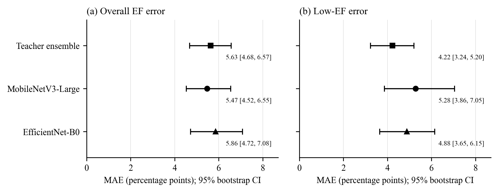
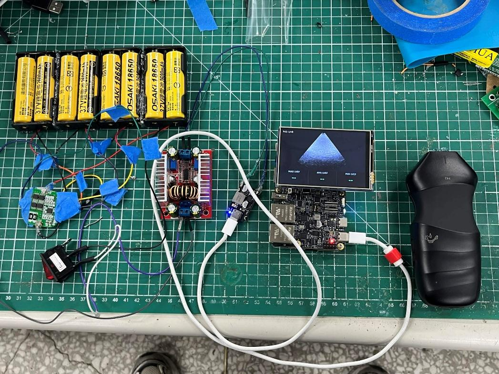
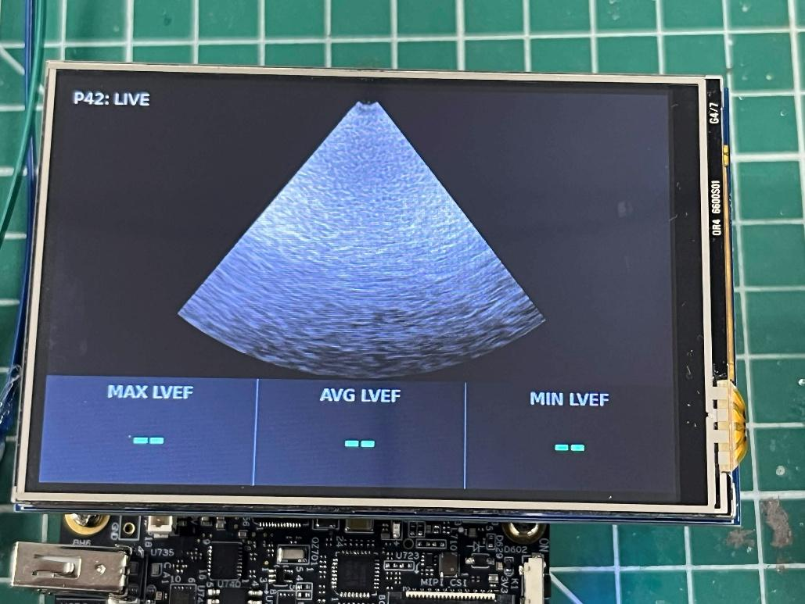
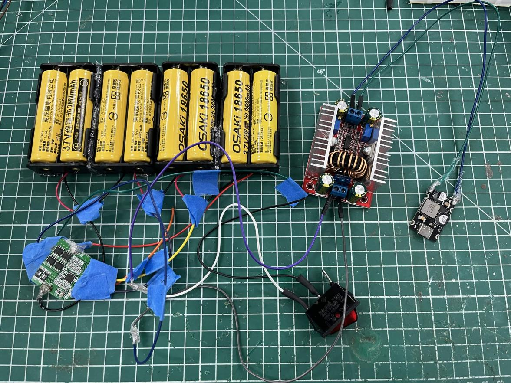
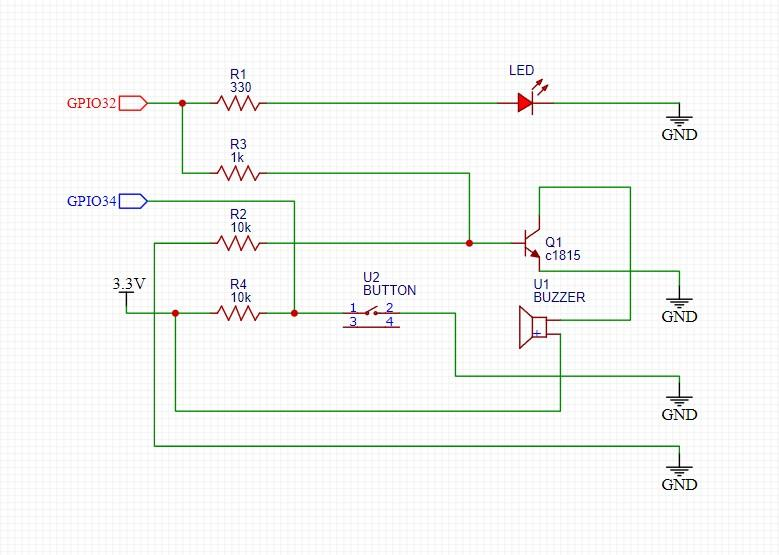
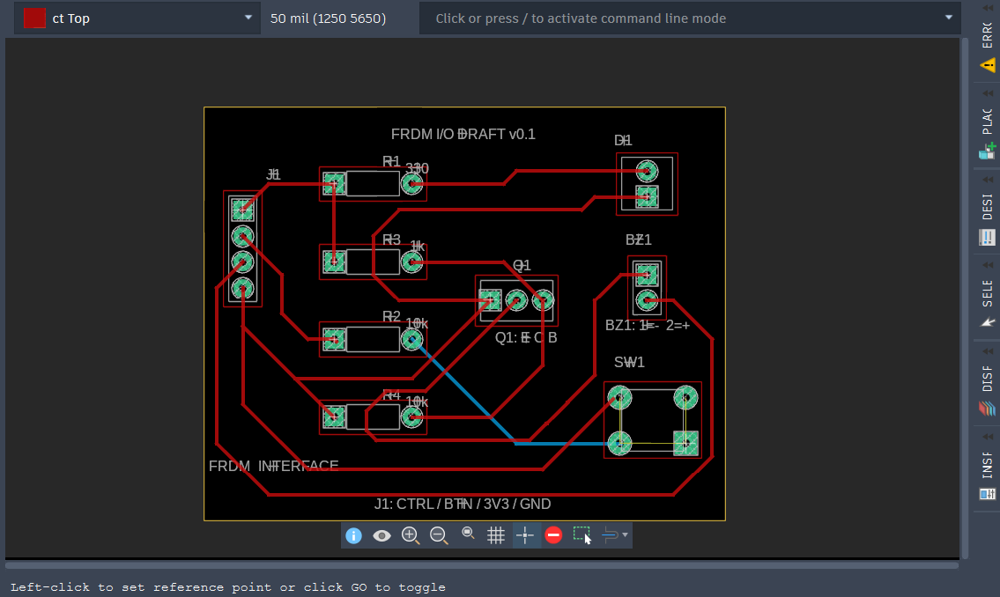
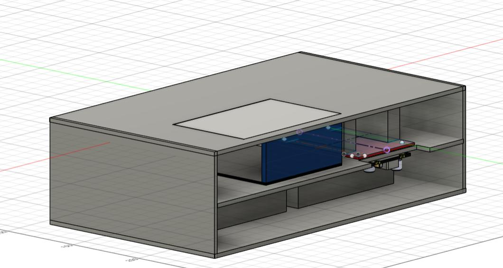

# EdgeLVEF project figures

## Model architecture

Figure 1. Two R(2+1)D-18 Teachers supply EF and 512-D feature targets during offline learning. The Student combines MobileNetV3-Large, temporal shift, frame projection, residual depthwise temporal convolution and mean/max pooling. Report supervision, EF distillation, low-EF soft targets and cosine feature alignment form the training objective. Teacher and projector are training-only. Readiness Gate remains a separate input-assessment module.

The [method](../research/plax_lvef/METHOD.md) and [architecture source](../edgelvef/research/video_distillation.py) define the dimensions and coefficients. [Figure-generation specification](assets/architecture-generation.md) records the exact diagram content.

## Controlled model comparison

Figure 2. Six Student encoders under the shared temporal and training design. Parameter count describes network size; the EF-error panel uses the same 82-study development benchmark. Solid black highlights the selected MobileNetV3-Large Student.

Figure 3. Overall and low-EF MAE point estimates with bootstrap 95% intervals for the Teacher ensemble and two Student options. Values are read from the aggregate CSV. [PNG and vector PDF generation](assets/generate_benchmark_figures.py) is reproducible.

## Device assembly and image display

Figure 4. Aco P42 probe, i.MX93 board and display assembly.

Figure 5. Board, display, probe and power-supply assembly.

Figure 6. Physical display showing the acquired ultrasound image and the Linux application's EF result fields.

## Power and peripheral design

Figure 7. Power-supply assembly included in the project description.

Figure 8. Indicator, buzzer and button circuit schematic.

Figure 9. Peripheral PCB layout.

Figure 10. Enclosure CAD design.

Device and hardware images are original embedded artwork from *EdgeLVEF 作品說明書 4.0*, pages 4–6 and 8. [Source manifest](assets/project/source_manifest.json) records page numbers, image dimensions and checksums. [Extraction utility](assets/extract_project_figures.py) preserves the embedded source images.

## Publication files

- Architecture: [PNG](assets/edgelvef-architecture.png), [vector PDF](assets/edgelvef-architecture.pdf), [editable SVG](assets/edgelvef-architecture.svg).
- Backbone comparison: [PNG](assets/student-backbone-comparison.png), [vector PDF](assets/student-backbone-comparison.pdf), [SVG](assets/student-backbone-comparison.svg).
- EF intervals: [PNG](assets/ef-error-intervals.png), [vector PDF](assets/ef-error-intervals.pdf), [SVG](assets/ef-error-intervals.svg).
